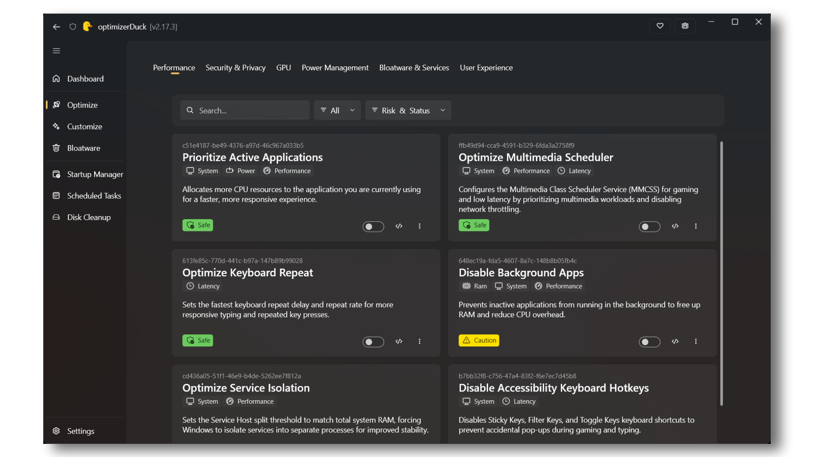

# ‏[optimizerDuck](https://optimizerduck.vercel.app/)

**ابزار بهینه‌سازی رایگان و متن‌باز ویندوز با تمرکز بر عملکرد، حریم خصوصی و سادگی.**

 

 

 

**[شروع به کار](https://optimizerduck.vercel.app/docs/guides/getting-started) | [نحوه عملکرد](https://optimizerduck.vercel.app/docs/guides/how-it-works) | [سؤالات متداول](https://optimizerduck.vercel.app/docs/faq/general)**

‏[English](../../README.md) | [Tiếng Việt](README.vi.md) | [繁體中文](README.zh-TW.md) | [简体中文](README.zh-CN.md) | [Русский](README.ru-RU.md) | [Français](README.fr-FR.md) | [한국어](README.ko-KR.md) | [Español](README.es-ES.md) | [日本語](README.ja-JP.md) | [Português (BR)](README.pt-BR.md) | [Türkçe](README.tr-TR.md) | [العربية](README.ar-SA.md) | [Bahasa Indonesia](README.id-ID.md) | [Italiano](README.it-IT.md) | **فارسی**

⭐ تاریخچه ستاره‌ها

اگر optimizerDuck به بهبود کامپیوتر شما کمک کرده است، لطفاً به مخزن یک ⭐ بدهید و آن را با دیگران به اشتراک بگذارید.
هر ستاره به ایجاد انگیزه برای بهبودهای آینده کمک می‌کند.

 <a href="https://www.star-history.com/itsfatduck/optimizerduck">
  <picture>
   <source media="(prefers-color-scheme: dark)" srcset="https://api.star-history.com/badge?repo=itsfatduck/optimizerDuck&theme=dark" />
   <source media="(prefers-color-scheme: light)" srcset="https://api.star-history.com/badge?repo=itsfatduck/optimizerDuck" />
   
  </picture>
 </a>

<a href="https://www.star-history.com/?repos=itsfatduck%2FoptimizerDuck&type=date&legend=top-left">
 <picture>
   <source media="(prefers-color-scheme: dark)" srcset="https://api.star-history.com/chart?repos=itsfatduck/optimizerDuck&type=date&theme=dark&legend=top-left&sealed_token=UNXQhgyDBTZTQe1TE_Amu7Y7vpRg39O9VlDWdODQoVZHQMYgQvez_20mmRYsz_G_4P0WqF9EcECI9q3FgCwrudjZ0tvJ6st0cC6W0H6RPKncHmlV1RtXn1ys51oMBWeTQ8nkSmR9huOtNdEp4jh_wiWqmmc7j6HgfHRK9WlbIoHnGgLyskwm6agLLmWR" />
   <source media="(prefers-color-scheme: light)" srcset="https://api.star-history.com/chart?repos=itsfatduck/optimizerDuck&type=date&legend=top-left&sealed_token=UNXQhgyDBTZTQe1TE_Amu7Y7vpRg39O9VlDWdODQoVZHQMYgQvez_20mmRYsz_G_4P0WqF9EcECI9q3FgCwrudjZ0tvJ6st0cC6W0H6RPKncHmlV1RtXn1ys51oMBWeTQ8nkSmR9huOtNdEp4jh_wiWqmmc7j6HgfHRK9WlbIoHnGgLyskwm6agLLmWR" />
   
 </picture>
</a>

<a href="https://starmapper.bruniaux.com/itsfatduck/optimizerDuck">
  <picture>
    <source media="(prefers-color-scheme: dark)" srcset="https://starmapper.bruniaux.com/api/map-image/itsfatduck/optimizerDuck?theme=dark" />
    <source media="(prefers-color-scheme: light)" srcset="https://starmapper.bruniaux.com/api/map-image/itsfatduck/optimizerDuck?theme=light" />
    
  </picture>
</a>

---

## شروع سریع

1. دانلود از **[انتشارهای گیت‌هاب (GitHub Releases)](https://github.com/itsfatduck/optimizerDuck/releases/latest)**
2. فایل `.exe` را مستقیماً اجرا کنید، نیازی به نصب نیست
3. بهینه‌سازی‌های مورد نظر خود را انتخاب کرده، آن‌ها را اعمال کنید و هر زمان که آماده بودید کامپیوتر خود را مجدداً راه‌اندازی کنید

> [!TIP]
> همیشه قبل از اعمال تغییرات، یک **نقطه بازیابی سیستم (System Restore Point)** ایجاد کنید.

> [!NOTE]
> | | زبان | نام بومی | مترجم |
> |------|----------|-------------|------------|
> | 🇺🇸 | انگلیسی (ایالات متحده) | English | اصلی و پیشنهادی |
> | 🇻🇳 | ویتنامی | Tiếng Việt | [itsfatduck](https://github.com/itsfatduck) |
> | 🇹🇼 | چینی سنتی | 正體中文 | [abc0922001](https://github.com/abc0922001) |
> | 🇨🇳 | چینی ساده‌شده | 简体中文 | [wcxu21](https://github.com/wcxu21) |
> | 🇷🇺 | روسی | Русский | [Foodhead](https://github.com/Foodhead) |
> | 🇫🇷 | فرانسوی | Français | [Robocnop](https://github.com/Robocnop) |
> | 🇩🇪 | آلمانی | Deutsch | [pixeldepartment](https://github.com/pixeldepartment) |
> | 🇮🇱 | عبری | עברית | [yosef-chai](https://github.com/yosef-chai) |
> | 🇰🇷 | کره‌ای | 한국어 | [klfnn](https://github.com/klfnn) |
> | 🇪🇸 | اسپانیایی | Español | [thexxtt](https://github.com/thexxtt) |
> | 🇯🇵 | ژاپنی | 日本語 | [zerofrip](https://github.com/zerofrip) |
> | 🇵🇱 | لهستانی | Polski | [dudus2000](https://github.com/dudus2000) |
> | 🇧🇷 | پرتغالی (برزیل) | Português (Brasil) | [mhanelia](https://github.com/mhanelia) |
> | 🇹🇷 | ترکی | Türkçe | [amhunter1](https://github.com/amhunter1) |
> | 🇸🇦 | عربی | العربية | [s5xx5s](https://github.com/s5xx5s) |
> | 🇮🇩 | اندونزیایی | Bahasa Indonesia | [nekowawolf](https://github.com/nekowawolf) |
> | 🇮🇹 | ایتالیایی | Italiano | [bandrea83](https://github.com/bandrea83) |
> | 🇮🇷 | فارسی | فارسی | [NimaHp](https://github.com/NimaHp) |
> 
> می‌خواهید زبان خود را اضافه کنید؟ به [CONTRIBUTING.md](../../CONTRIBUTING.md) ([ژاپنی](../contributing/CONTRIBUTING.ja-JP.md)، [ترکی](../contributing/CONTRIBUTING.tr-TR.md)) مراجعه کنید.

---

## ‏optimizerDuck چه کاری انجام می‌دهد و چرا اهمیت دارد

ویندوز به صورت پیش‌فرض عملکرد بسیار خوبی دارد. با این حال، یک نصب تازه شامل سرویس‌های پس‌زمینه، تله‌متری (داده‌های تشخیصی)، برنامه‌های از پیش نصب‌شده و وظایف زمان‌بندی‌شده‌ای است که حتی اگر هرگز از آن‌ها استفاده نکنید، به کار خود ادامه می‌دهند. این موارد منابع سیستمی مانند پردازنده (CPU)، رم (RAM)، دیسک و شبکه را در پس‌زمینه مصرف می‌کنند.

در عین حال، بسیاری از تنظیماتی که می‌توانند عملکرد را بهبود ببخشند، تأخیر را کاهش دهند یا تجربه روان‌تری را ارائه دهند، به صورت پیش‌فرض فعال نیستند.

‏optimizerDuck همه چیز را در یک جا گرد هم می‌آورد. این ابزار به شما کمک می‌کند ویندوز را بهینه کنید، اجزای غیرضروری را حذف کنید، تنظیمات سیستم را سفارشی‌سازی کنید و ویژگی‌های رایج ویندوز را بدون نیاز به جستجو در Registry، خط مشی گروهی (Group Policy) یا PowerShell مدیریت کنید.

همچنین این برنامه شامل ابزارهای مدیریتی داخلی است که به شما امکان می‌دهد ببینید چه چیزی در حال اجرا است، آنچه را که نیاز ندارید حذف کنید و در صورت نیاز تغییرات را بازگردانی کنید.

**[چرا ویندوز را بهینه کنیم؟](#چرا-به-جای-ارتقای-سخت‌افزار-ویندوز-را-بهینه-کنیم)**

### بهینه‌سازی‌های سیستم

۴۲ ترفند در ۷ دسته‌بندی، که هر کدام دارای توضیحی واضح و رتبه‌بندی ریسک هستند تا دقیقاً بدانید هر تغییر پیش از اعمال شدن چه کاری انجام می‌دهد.

| دسته‌بندی | پوشش‌دهی |
| :--- | :--- |
| **عملکرد (Performance)** | تنظیم سرویس‌های میزبان (Service host) بر اساس رم شما، تنظیمات اولویت فرآیند، کاهش تاخیر صفحه کلید و تغییرات زمان‌بندی چندرسانه‌ای برای بازی‌های روان‌تر |
| **حریم خصوصی (Privacy)** | غیرفعال‌سازی تله‌متری ویندوز، گزارش خطا، شناسه تبلیغاتی، ردیابی موقعیت مکانی، کورتانا، Copilot و پیشنهادات تحویل محتوا |
| **پردازنده گرافیکی (GPU)** | ترفندهای Registry مخصوص سازندگان برای پردازنده‌های گرافیکی AMD، NVIDIA و اینتل، پوشش‌دهی حالت‌های توان، ساعت گیتینگ و تأخیر نمایشگر |
| **توان (Power)** | غیرفعال‌سازی Hibernation و راه‌اندازی سریع (Fast startup)، خاموش کردن تعلیق انتخابی USB، نصب طرح توان با کارایی بالا سفارشی و غیرفعال‌سازی محدودیت توان (Power throttling) |
| **برنامه‌های اضافی و سرویس‌ها (Bloatware & Services)** | مسدود کردن رفتار نصب مجدد برنامه‌های OEM و تنظیم دقیق انواع راه‌اندازی برای بیش از ۲۰۰ سرویس ویندوز |
| **تجربه کاربری (User Experience)** | حذف تاخیرهای نمایش منو، غیرفعال‌سازی جلوه‌های بصری مانند انیمیشن‌های نوار وظیفه و شفافیت برای حس پویایی بیشتر |
| **هوش مصنوعی (AI)** | غیرفعال‌سازی اسنپ‌شات‌های Windows Recall و لایه هوش مصنوعی Click To Do (ویندوز ۱۱) |

> [!NOTE]
> بهینه‌سازی‌های موجود در اینجا از ابزارهای شناخته‌شده با پایگاه‌های کاربری بزرگ تحقیق شده‌اند، هیچ‌چیز توسط هوش مصنوعی تولید نشده یا کورکورانه اضافه نشده است. هر ترفند برای تاثیرگذاری در دنیای واقعی انتخاب شده است.

### سفارشی‌سازی

۴۴ تنظیم در ۴ دسته‌بندی. نیازی به جستجو در Registry نیست، فقط کلیدهای ضامن، منوهای کشویی و ورودی‌های عددی در یک جا ارائه شده‌اند:

- **دسکتاپ**: نمایش یا پنهان کردن آیکون‌ها (این پی‌سی، سطل بازیافتنی، شبکه، فایل‌های کاربر، کنترل پنل، تمام آیکون‌های دسکتاپ)، حذف پوشش‌های فلش میانبر
- **ترجیحات**: تراز نوار وظیفه، ابزارک‌ها (Widgets)، نمای وظیفه (Task View)، دکمه‌های پایان دادن به کار (End Task) و آخرین کلیک فعال، نمایش کادر جستجو، ثانیه‌های ساعت، حالت تاریک، پسوندهای فایل، فایل‌های مخفی، تاریخچه کلیپ‌بورد، نمای فشرده، دستیار چیدمان (Snap assist)، چک‌باکس‌های موارد، منوی زمینه کلاسیک، جستجوی بینگ، اعلان‌های توست و همگام‌سازی، پیشنهادات سیستم، تکان دادن پنجره (Window shake)، و راه‌اندازی فایل اکسپلورر در بخش This PC
- **بازی**: حالت بازی (Game Mode)، نوار بازی (Game Bar)، ضبط پس‌زمینه، شتاب ماوس، بهینه‌سازی‌های تمام‌صفحه، زمان‌بندی پردازنده گرافیکی شتاب‌یافته سخت‌افزاری
- **سیستم**: قفل عددی (Num Lock) در هنگام بوت، حالت توسعه‌دهنده (Developer Mode)، سایدلود کردن برنامه‌های مورد اعتماد، مسیرهای طولانی و درصد باتری

### ابزارهای داخلی

| ابزار | کاری که انجام می‌دهد |
| :--- | :--- |
| **داشبورد سیستم (System Dashboard)** | مشاهده جزئیات پردازنده، رم، پردازنده گرافیکی، درایوهای ذخیره‌سازی و سیستم‌عامل در یک پنل |
| **مدیر راه‌اندازی (Startup Manager)** | مشاهده هر برنامه و وظیفه‌ای که در هنگام بوت راه‌اندازی می‌شود، روشن یا خاموش کردن آن‌ها و باز کردن محل فایل آن‌ها |
| **وظایف زمان‌بندی‌شده (Scheduled Tasks)** | مرور، اجرا، توقف، فعال‌سازی، غیرفعال‌سازی یا حذف وظایف زمان‌بندی‌شده ویندوز |
| **پاک‌سازی دیسک (Disk Cleanup)** | اسکن و پاکسازی فایل‌های موقت، کش سیستم، باقی‌مانده‌های به‌روزرسانی ویندوز، Prefetch، بندانگشتی‌ها، سطل بازیافتنی، دامپ‌های کرش و نصب‌های قدیمی ویندوز |
| **حذف‌کننده برنامه‌های اضافی (Bloatware Remover)** | فهرست کردن تمام بسته‌های AppX قابل حذف با برچسب‌های ریسک (ایمن، احتیاط، ناشناخته)، تا بتوانید آنچه را که می‌خواهید حذف کنید انتخاب کنید |

### چرا به جای ارتقای سخت‌افزار ویندوز را بهینه کنیم؟

سریع‌ترین راه برای بهبود عملکرد همیشه ارتقای سخت‌افزار است. یک پردازنده، پردازنده گرافیکی، رم بیشتر یا یک SSD سریع‌تر معمولاً بهبودهای بسیار بیشتری نسبت به ترفندهای نرم‌افزاری به تنهایی ارائه می‌دهد.

اما سخت‌افزار تنها بخشی از تصویر است.

ویندوز برای صدها میلیون رایانه شخصی با سخت‌افزار، بارهای کاری و کاربران مختلف طراحی شده است. به همین دلیل، مایکروسافت ویندوز را با تنظیماتی عرضه می‌کند که به جای حداکثر عملکرد، سازگاری، پایداری، عمر باتری و سادگی استفاده را در اولویت قرار می‌دهند.

در نتیجه، نصب پیش‌فرض ویندوز شامل بسیاری از سرویس‌های پس‌زمینه، وظایف زمان‌بندی‌شده، تله‌متری، ویژگی‌های صرفه‌جویی در مصرف انرژی و برنامه‌های از پیش نصب‌شده است که ممکن است بسیاری از کاربران هرگز به آن‌ها نیاز نداشته باشند.

این امر به‌ویژه پس از نصب مجدد ویندوز صادق است. حتی پس از نصب تمام درایورها و به‌روزرسانی‌ها، بسیاری از تنظیمات مفید مربوط به عملکرد دست‌نخورده باقی می‌مانند، در حالی که اجزای غیرضروری پس‌زمینه به کار خود ادامه می‌دهند.

بهینه‌سازی ویندوز صرفاً به معنای کاهش سربار غیرضروری است تا رایانه شخصی شما بتواند منابع بیشتری را صرف چیزهایی کند که در واقع اهمیت دارند، چه بازی، برنامه‌نویسی، تولید محتوا یا کار روزمره.

این کار به طور جادویی فریم‌بر ثانیه (FPS) شما را دو برابر نمی‌کند، اما می‌تواند فعالیت پس‌زمینه را کاهش دهد، تأخیر سیستم را پایین بیاورد، پاسخگویی را بهبود بخشد و به سخت‌افزار شما کمک کند عملکرد یکنواخت‌تری داشته باشد.

این همچنین یکی از دلایلی است که بسیاری از مردم لینوکس را برای عملکرد بهتر و سربار کمتر سیستم توصیه می‌کنند. اگر ترجیح می‌دهید به دلیل سازگاری نرم‌افزاری و تجربه آشنا، روی ویندوز بمانید، optimizerDuck به شما کمک می‌کند بدون تغییر سیستم‌عامل، بهترین تجربه ممکن را داشته باشید.

### چه زمانی باید ویندوز را بهینه کنم؟

بهترین زمان **پس از راه‌اندازی یک نصب تازه ویندوز** است.

ما این ترتیب را پیشنهاد می‌کنیم:

1. نصب ویندوز.
2. نصب تمام درایورهای سخت‌افزاری (چیپست، پردازنده گرافیکی، شبکه، صدا و غیره).
3. اجرای **Windows Update** تا زمانی که به‌روزرسانی دیگری موجود نباشد.
4. نصب تمام **به‌روزرسانی‌های اختیاری (Optional Updates)**.
5. باز کردن **مایکروسافت استور (Microsoft Store)** و به‌روزرسانی تمام برنامه‌های داخلی.
6. نصب نرم‌افزار و بازی‌هایی که معمولاً استفاده می‌کنید.
7. اعمال بهینه‌سازی‌های دلخواه optimizerDuck.
8. استفاده از ابزارهای داخلی optimizerDuck برای حذف برنامه‌های غیرضروری، پاکسازی ویندوز و مدیریت برنامه‌های راه‌اندازی (Startup).

پیروی از این ترتیب کمک می‌کند تا از بازنویسی بهینه‌سازی‌های شما توسط ویندوز یا به‌روزرسانی‌های درایور در آینده جلوگیری شود.

> [!TIP]
> بسیاری از کاربران پیشرفته ترجیح می‌دهند پس از اتمام راه‌اندازی، به‌روزرسانی‌های خودکار ویندوز را به طور موقت غیرفعال کنند. به‌روزرسانی‌های بزرگ ویندوز ممکن است تنظیمات پیش‌فرض را بازگردانند، برخی از اجزا را دوباره نصب کنند یا برخی از بهینه‌سازی‌ها را خنثی کنند. اگر این کار را انجام دادید، به یاد داشته باشید که قبل از غیرفعال کردن مجدد Windows Update، به طور دوره‌ای آن را فعال کنید تا به‌روزرسانی‌های امنیتی مهم را نصب کنید.

> [!NOTE]
> هر بهینه‌سازی ارائه شده توسط optimizerDuck را می‌توان به صورت دستی نیز انجام داد. هدف optimizerDuck صرفاً آسان‌تر، ایمن‌تر و راحت‌تر کردن بهینه‌سازی ویندوز است.

---

## ایمنی

تغییر تنظیمات سیستم با خطر همراه است. optimizerDuck بر اساس قابلیت بازگشت (Reversibility) و کنترل کاربر ساخته شده است.

برای جزئیات بیشتر در مورد رویه‌های داده ما، به [سیاست حفظ حریم خصوصی](../../PRIVACY.md) مراجعه کنید.

- **پشتیبان‌گیری خودکار**: هر تغییر یک فایل بازگردانی (Revert file) در یک پوشه محلی می‌نویسد. شما می‌توانید ترفندهای فردی را بازیابی کنید یا همه چیز را به حالت اول بازگردانید.
- **بازگردانی با یک کلیک**: هر بهینه‌سازی اعمال‌شده را از رابط کاربری با یک کلیک لغو کنید.
- **رتبه‌بندی ریسک**: هر ترفند بر اساس تأثیر بالقوه خود به عنوان امن، با احتیاط یا تخصصی برچسب‌گذاری می‌شود.
- **هیچ پیش‌فرضی اعمال نمی‌شود**: هیچ‌چیز اجرا نمی‌شود مگر اینکه آن را انتخاب کنید. این ابزار به خودی خود هیچ‌چیزی را فعال نمی‌کند.
- **درخواست نقطه بازیابی**: قبل از اولین بهینه‌سازی، برنامه پیشنهاد می‌کند یک نقطه بازیابی ویندوز ایجاد کنید.

---

## سؤالات متداول

> [!TIP]
> برای سؤالات و پاسخ‌های بیشتر به [سؤالات متداول وب‌سایت](https://optimizerduck.vercel.app/docs/faq/general) مراجعه کنید.

### آیا استفاده از optimizerDuck امن است؟

بله. optimizerDuck کاملاً **متن‌باز** (GPL v3) است، به این معنی که هر کسی می‌تواند کد منبع را خودش بررسی، ممیزی یا بسازد. هر نسخه به طور خودکار توسط **GitHub Actions** از منبع عمومی ساخته می‌شود؛ هیچ تغییر پنهانی وجود ندارد، هیچ باینری امضا نشده‌ای پس از ساخت تزریق نمی‌شود. اگر ترجیح می‌دهید، می‌توانید مخزن را کلون کرده و با یک `dotnet build` ساده، فایل `.exe` را خودتان بسازید.

این برنامه **هیچ‌گونه** تله‌متری، داده‌های مصرفی یا اطلاعات شخصی را جمع‌آوری نمی‌کند. به [سیاست حفظ حریم خصوصی](../../PRIVACY.md) مراجعه کنید.

### آیا optimizerDuck واقعاً عملکرد را بهبود می‌بخشد، تاخیر را کاهش می‌دهد یا شبکه من را سریع‌تر می‌کند؟

می‌تواند کمک کند. هر بهینه‌سازی در optimizerDuck از **ابزارهای شناخته‌شده، راهنمای انجمن‌ها و توصیه‌های سازندگان سخت‌افزار** تحقیق شده است، هیچ‌چیز توسط هوش مصنوعی تولید نشده، کورکورانه اضافه نشده یا ساخته نشده است. هر ترفند به یک تنظیم واقعی می‌پردازد که ویندوز به طور پیش‌فرض آن را محافظه‌کارانه پیکربندی می‌کند (مانند دسته‌بندی سرویس میزبان، حالت‌های توان پردازنده گرافیکی، محدودیت شبکه، زمان‌بندی فرآیند).

هیچ هک تقلبی Registry در اینجا وجود ندارد، هر تغییر دارای یک هدف مستند و تأثیر در دنیای واقعی است که توسط تست‌های انجمن و مستندات سازنده پشتیبانی می‌شود.

### چرا Windows SmartScreen / Defender دانلود را علامت‌گذاری (Flag) می‌کند؟

‏optimizerDuck دارای امضای کد (Code-signed) نیست زیرا گواهی‌های امضای کد برای پروژه‌های متن‌باز گران هستند. هنگامی که ویندوز با یک فایل اجرایی امضا نشده دانلود شده از اینترنت مواجه می‌شود، SmartScreen به طور پیش‌فرض هشدار می‌دهد. این طبیعی است و به این معنا **نیست** که فایل ناامن است.

برای دور زدن، روی **"More info" > "Run anyway"** کلیک کنید. اگر همچنان نگران هستید:

- فایل `.exe` را خودتان از [سورس](https://github.com/itsfatduck/optimizerDuck) بسازید.
- فایل باینری را برای تأیید مستقل به سندباکس‌های آنلاین مانند ANY.RUN ارسال کنید.

### اگر مشکلی پیش آمد آیا می‌توانم تغییرات را بازگردانی کنم؟

بله. هر بهینه‌سازی قبل از اعمال، یک فایل بازگردانی ایجاد می‌کند. شما می‌توانید ترفندهای فردی را لغو کنید یا همه چیز را از رابط کاربری با یک کلیک به حالت اول بازگردانید. این برنامه همچنین پیشنهاد می‌کند قبل از اولین بهینه‌سازی، یک نقطه بازیابی سیستم ویندوز ایجاد کنید.

### آیا این روی ویندوز ۱۰ و ویندوز ۱۱ کار می‌کند؟

بله. optimizerDuck از **ویندوز ۱۰ و ۱۱ (x64 و ARM64)** پشتیبانی می‌کند.

### آیا به دسترسی مدیر (Administrator) نیاز دارم؟

بله. optimizerDuck تنظیمات سیستم و Registry ویندوز را تغییر می‌دهد، بنابراین برای اجرا نیاز به دسترسی‌های مدیریتی دارد.

### آیا optimizerDuck داده‌های من را جمع‌آوری می‌کند؟

خیر. این برنامه شامل صفر تله‌متری، تجزیه و تحلیل یا عملکرد ارسال اطلاعات به سرور است. این برنامه به طور کامل آفلاین اجرا می‌شود و هیچ داده‌ای را به هیچ جایی ارسال نمی‌کند.

### چرا پس از اعمال طرح توان، Task Manager استفاده از CPU را 100% نشان می‌دهد؟ ([#29](https://github.com/itsfatduck/optimizerDuck/issues/29))

یک باگ شناخته‌شده در نمایش Task Manager که توسط طرح‌های توان غیرپیش‌فرض ایجاد می‌شود؛ این باگ به اشتباه در برخی از سیستم‌ها ۱۰۰ درصد CPU را گزارش می‌کند در حالی که بار واقعی نرمال است. این موضوع فقط بصری است و روی عملکرد واقعی تأثیر **نمی‌گذارد** یا باعث داغ شدن بیش از حد نمی‌شود. اگر ناخواسته است، به سادگی این بهینه‌سازی را خاموش کنید.

---

## عیب‌یابی

> [!TIP]
> برای راهنمایی دقیق‌تر و راه‌حل‌های مشکلات شناخته‌شده، به [صفحه عیب‌یابی](https://optimizerduck.vercel.app/docs/faq/troubleshooting) مراجعه کنید.

### برنامه اجرا نمی‌شود یا در هنگام راه‌اندازی کرش می‌کند

مطمئن شوید که به عنوان **Administrator** در حال اجرای برنامه هستید. optimizerDuck به دسترسی‌های ارتقا یافته نیاز دارد. اگر همچنان کرش کرد، آخرین نسخه را از [Releases](https://github.com/itsfatduck/optimizerDuck/releases/latest) دانلود کنید؛ یک نسخه قدیمی ممکن است با نسخه ویندوز شما سازگار نباشد.

### تغییرات پس از اعمال به نظر می‌رسد اعمال نمی‌شوند

برخی از بهینه‌سازی‌ها برای اعمال کامل نیاز به **راه‌اندازی مجدد سیستم** دارند. اگر به نظر می‌رسد یک ترفند پس از راه‌اندازی مجدد کار نمی‌کند، سعی کنید دوباره آن را اعمال کنید یا بخش بازگردانی را بررسی کنید تا مطمئن شوید تغییرات ذخیره شده است.

### فایل بازگردانی گم شده یا خراب شده است

فایل‌های بازگردانی در `%LocalAppData%\optimizerDuck\Revert\` ذخیره می‌شوند. اگر فایلی به طور تصادفی حذف یا خراب شود، می‌توانید آن را از یک نسخه پشتیبان بازیابی کنید یا به عنوان پشتیبان، از قبل یک **نقطه بازیابی سیستم (System Restore Point)** ایجاد کنید.

### به‌روزرسانی ویندوز تنظیمات من را بازنشانی می‌کند

به‌روزرسانی‌های ویژگی‌های ویندوز گهگاه مقادیر خاص Registry و پیکربندی سرویس‌ها را به پیش‌فرض بازمی‌گردانند. پس از یک به‌روزرسانی بزرگ، به سادگی بهینه‌سازی‌های قبلی خود را از برنامه دوباره اعمال کنید.

### باگ پیدا کردم / می‌خواهم درخواستی برای یک ویژگی بدهم

یک [موضوع (Issue)](https://github.com/itsfatduck/optimizerDuck/issues) در گیت‌هاب با جزئیات کامل باز کنید: نسخه ویندوز خود، آنچه اعمال کرده‌اید و چه چیزی اشتباه پیش رفته است. درخواست‌های ویژگی نیز استقبال می‌شوند.

---

## جزئیات فنی

- **فریم‌ورک**: WPF روی .NET 10، با استفاده از کتابخانه WPF UI برای طراحی Fluent
- **سیستم بازگردانی**: چهار نوع مرحله بازگردانی (Registry، Service، Scheduled Task، Shell) با حالت ماندگار JSON و ورودی/خروجی فایل ایمن از نظر رشته (Thread-safe)
- **تم‌بندی**: حالت‌های تاریک (پیش‌فرض)، روشن و کنتراست بالا با پشتیبانی از پس‌زمینه میکا (Mica backdrop)
- **بدون نصب‌کننده**: به عنوان یک فایل `.exe` منفرد اجرا می‌شود، نیازی به نصب نیست
- **سیستم پشتیبان‌گیری**: پشتیبان‌گیری مبتنی بر پوشه محلی برای هر تغییر، با بازیابی با یک کلیک
- **کشف**: دسته‌بندی‌های بهینه‌سازی و ویژگی‌ها به طور خودکار از طریق Reflection + ویژگی‌های سفارشی کشف می‌شوند، بدون نیاز به ثبت دستی
- **بدون تله‌متری**: برنامه هیچ‌گونه داده کاربری را جمع‌آوری نمی‌کند

---

## مستندات

### [مستندات رسمی](https://optimizerduck.vercel.app/docs/guides/getting-started)

راهنماها، جزئیات بهینه‌سازی و نکات استفاده.

---

## مشارکت

گزارش‌های باگ، بهینه‌سازی‌های جدید، بهبود مستندات و ترجمه‌ها همگی استقبال می‌شوند. به [CONTRIBUTING.md](../../CONTRIBUTING.md) ([ژاپنی](../contributing/CONTRIBUTING.ja-JP.md)، [ترکی](../contributing/CONTRIBUTING.tr-TR.md)) مراجعه کنید.

---

## جامعه

> [!TIP]
> برای پشتیبانی، نکات و گفتگو با سایر کاربران و مشارکت‌کنندگان به سرور دیسکورد ما بپیوندید.
>
> 

اگر optimizerDuck به رایانه شما کمک کرده است:

- ⭐ به مخزن ستاره بدهید
- 💬 برای پشتیبانی به دیسکورد بپیوندید
- 🐞 باگ‌ها را در گیت‌هاب گزارش کنید
- 🎁 از پروژه [اینجا](https://optimizerduck.vercel.app/docs/contribute/support-me) حمایت کنید

### لینک‌ها

- 🌐 [وب‌سایت](https://optimizerduck.vercel.app/)
- 📖 [مستندات](https://optimizerduck.vercel.app/docs/guides/getting-started)
- 💬 [دیسکورد](https://discord.gg/tDUBDCYw9Q)
- 🐞 [مسائل (Issues)](https://github.com/itsfatduck/optimizerDuck/issues)

گزارش‌های باگ، پیشنهادات ویژگی، ترجمه‌ها و به اشتراک گذاری تجربه شما همگی به پروژه کمک می‌کنند.

---

## سلب مسئولیت

‏optimizerDuck بدون هیچ‌گونه ضمانتی، **"همان‌طور که هست" (as is)** ارائه می‌شود.

با استفاده از این ابزار، شما موافقت می‌کنید که نویسندگان هیچ مسئولیتی در قبال ناپایداری سیستم، از دست رفتن داده‌ها یا مشکلات ناشی از نرم‌افزارهای شخص ثالث یا تغییرات کاربر ندارند.

همیشه قبل از اعمال تغییرات، یک **نقطه بازیابی (Restore point)** ایجاد کنید.

> [!NOTE]
> ‏optimizerDuck تنظیمات سیستم و Registry ویندوز را تغییر می‌دهد. با مسئولیت خودتان استفاده کنید. ما توصیه می‌کنیم قبل از اعمال تغییرات، از داده‌های مهم پشتیبان‌گیری کنید و یک نقطه بازیابی ایجاد کنید.
>
> برای اطلاعات بیشتر به [شرایط خدمات](../../TERMS.md)، [سیاست حفظ حریم خصوصی](../../PRIVACY.md) و [سلب مسئولیت](../../DISCLAIMER.md) مراجعه کنید.

---

## مجوز

**[مجوز GPL v3](https://www.gnu.org/licenses/gpl-3.0.en.html)** به [LICENSE](../../LICENSE) مراجعه کنید.

## با تشکر از همه مشارکت‌کنندگان

 
[بازگشت به بالا](#optimizerduck)

